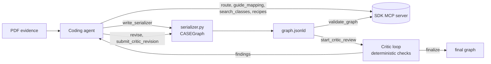
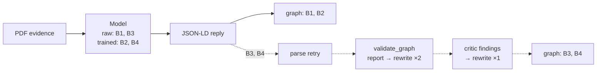
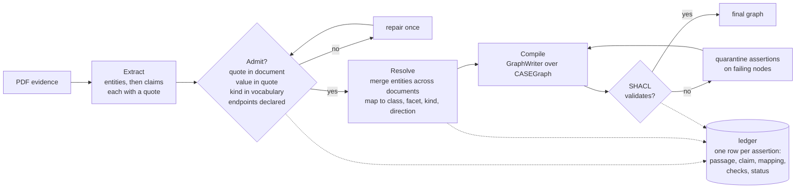
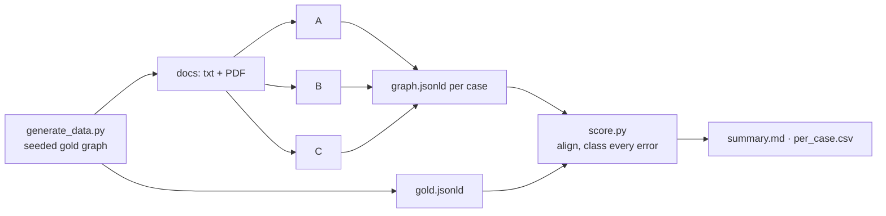

<h1 align="center">Evidence-Grounded Graph Construction</h1>
<h3 align="center">Evaluating Reliability and Fidelity in CASE/UCO Representations</h3>

<p align="center">
  <em>Data in. Graphs out. True to the source.</em>
</p>

<p align="center">
  <a href="#the-problem">Problem</a> ·
  <a href="#the-methods">Methods</a> ·
  <a href="#how-we-benchmark">Benchmark</a> ·
  <a href="#run-it">Run it</a> ·
  <a href="#whats-next">What's next</a>
</p>

---

## The problem

Making graphs that represent concepts from data is hard. Making knowledge graphs that faithfully reflect digital evidence is even harder.

When a language model turns case documents into [CASE](https://caseontology.org/)/[UCO](https://unifiedcyberontology.org/) graphs,
constructed graphs can be *valid* (or pass ontology's SHACL checks) without being ***correct***. A graph can be well-formed in every way the ontology can check and still represent things the documents never said.

We are experimenting with three approaches to developing reliable, faithful CASE/UCO representations from digital evidence. Here those terms mean:

- **Reliability**: does the method produce a graph at all, and does the graph validate?
- **Fidelity**: of the statements in the graph, how many does the source support, and can each claim be traced back to the evidence it came from?

Every method is benchmarked the same way, using the same PDF documents, base model, and scorer against gold graphs we author ourselves, and therefore know completely.

The SDK under test is Cory Hall's [CASE/UCO SDK](https://github.com/vulnmaster/CASE-UCO-SDK),
pinned as a submodule at `sdk/` (v1.33.0).

## The methods

Every method gets the same task statement (model only what the documents state; the core
classes; ten relation kinds), the same PDFs, and the same base model at temperature 0. They
differ in one thing: **how the graph is constructed.**

| arm | name | how the graph is constructed | status |
|---|---|---|---|
| **A** | SDK as shipped | the model writes a serializer script with the SDK, then revises it in the critic loop | built |
| **B1** | direct, raw | the model, in one reply | built |
| **B2** | direct, trained | a fine-tuned model, in one reply | placeholder |
| **B3** | direct, raw + defenses | the model, rewriting its reply from validator and critic reports | built |
| **B4** | direct, trained + defenses | a fine-tuned model, rewriting its reply from validator and critic reports | placeholder |
| **C** | evidence-grounded compilation | a compiler, from claims that passed the evidence gate | built |

B1 to B4 form a 2x2 (training x defenses) on direct generation, so the effect of each can be
separated. A is the practical engineering baseline. C is the architecture under test.

### A. The SDK as shipped

A coding agent gets the SDK's MCP server tools plus a file reader and a "save and run this
script" tool, and is asked to follow the SDK's documented workflow. The harness adds nothing to
the graph; every node comes from the serializer the agent wrote.



`harness/pipeline_sdk_agent.py`, arm `a_sdk_agent`. The graph at the agent's first validation
is also scored (`@first_validate`), so the QA loop's effect is visible.

### B. Direct generation

The model reads the documents and writes the CASE JSON-LD. B1 is the reply as is. B3 adds a
fixed, documented set of guards, each snapshotted and scored on its own: a parse retry, the
validator's report sent back for a rewrite, and the deterministic critic's findings sent back
for a rewrite. The guards never add to the graph; every version is a model reply. B2 and B4 are
the same two pipelines on a LoRA of the base model trained on generated cases that share nothing
with the benchmark.



`harness/pipeline_monolith.py` (B1, B2) and `harness/pipeline_defended.py` (B3, B4).
`harness/make_training_set.py` builds the training pairs; `harness/train_lora.py` holds the
training plan and is a placeholder until the checkpoint exists.

### C. Evidence-grounded graph compilation

The model never writes a graph or a serializer, and never chooses a class, facet or
relationship kind. It reads one document at a time and produces claims: the
entities the document names, then the attributes and relations among them, each with a verbatim
quote. A deterministic gate admits a claim only if the quote is in the document, the value is in
the quote, the relation kind is in the vocabulary and the endpoints are declared. A resolver
merges entities across documents and maps each admitted claim to its ontology construct (class,
facet placement, typed range, relationship kind and direction). A compiler writes the graph with
the SDK. A validation gate quarantines assertions on nodes that fail. Everything not asserted
stays in a ledger marked for review; nothing is dropped silently.



`harness/pipeline_grounded.py`, arm `c_grounded`. `harness/pipeline_compiled.py` is the
single-shot version (one reader call per document, no domain/range resolution, no ledger, no
gate), kept as C's ablation.

**Hypothesis.** Separating evidence extraction from ontology mapping, and enforcing provenance at
graph-construction time, reduces unsupported assertions and incorrect relationships without
sacrificing useful coverage.

Why C is shaped this way: the baseline error analysis showed that most of what the model gets
wrong is modeling, not reading. The largest error class was the right value on the right entity
under the wrong property; most of the rest were unanchored or invented nodes. A compiler cannot
misplace a property, and a verifier cannot admit a value the text does not contain. The model is
left with the part it is good at.

## How we benchmark

**100 cases, gold first.** Each case is a fraud or business-communication scenario. The gold
graph is authored by a seeded generator, then rendered into 2 to 4 documents (memo, email,
chat export, incident report) in which every gold statement is spoken in exactly one sentence.
Each document is a PDF with no annotations. The methods receive the PDFs and nothing else.

**Scoring.** The scorer aligns the produced graph to gold entity by entity, counts supported
statements, and classes every unsupported one: wrong value, wrong relation, wrong entity,
conflation across documents, misplaced property, duplicate entity, invented. A strict scorer and
a value-tolerant scorer are both reported. Failures (no graph) count as zero recall.

**Frozen protocol.** `harness/FROZEN.md` hashes the scorer, the generator, every gold graph and
every pipeline. Scores are comparable only between runs under the same entry.

**Splits.** `harness/data/` is the benchmark and is test only. `harness/data_dev/` (20 cases)
is for prompt and pipeline tuning; `harness/data_train/` (200 cases) is for the trained arms.
Different seeds, no shared case.

**Per-stage rows.** Any snapshot a pipeline leaves (`graph_<stage>.jsonld`) is scored as
`<arm>@<stage>`, so A before and after its QA loop, and B3 after each guard, show up as their
own rows.



## Run it

```bash
git clone --recurse-submodules https://github.com/mrinaalr/case-uco-graph-integrity.git && cd case-uco-graph-integrity
```

```bash
python3.13 -m venv .venv && .venv/bin/pip install -r requirements.txt
```

Put API keys in `harness/.env` (gitignored), named by `api_key_env` in `harness/config.toml`;
the default endpoint is Tinker's OpenAI-compatible API serving Qwen3.5-9B.

```bash
.venv/bin/python harness/pipeline_sdk_agent.py --run-id RUN --model tinker
```

```bash
.venv/bin/python harness/pipeline_monolith.py --run-id RUN --model tinker
```

```bash
.venv/bin/python harness/pipeline_defended.py --run-id RUN --model tinker
```

```bash
.venv/bin/python harness/pipeline_grounded.py --run-id RUN --model tinker
```

```bash
.venv/bin/python harness/score.py --run-id RUN
```

- `--cases case_01,case_02` runs a subset; `--data data_dev` runs on the dev set.
- Results go to `harness/results/RUN/`; `summary.md` has the per-arm table.
- `harness/generate_data.py --validate` regenerates the benchmark and its PDFs.
- [harness/README.md](harness/README.md) documents every arm, the data, and the scorer in detail.

## What's next

- Publish the clean 100-case results for A, B1, B3 and C under Freeze 5.
- Train the LoRA and fill in B2 and B4.
- An adversarial set: the same 100 cases with one injected attack per case (instruction, false
  fact, format, tool) and an "injected" error class in the scorer, to measure which method lets
  poisoned evidence into the graph and which leaves a trail to it.
- Tests with fixtures and mocked model replies, starting with the one that matters: a rejected
  claim cannot reach the graph.

## Limitations

The cases are synthetic. They test mechanics and known failure modes; they do not establish
fidelity on real case documents, which needs independently reviewed source-to-claim
annotations. One base model so far. C is not immune to false statements that are physically in
a document; what it adds is that every assertion is traceable to the passage that produced it.

## History

[DIRECTION.md](DIRECTION.md) records the study of the SDK's critic loop that led here, and
[EXPERIMENT.md](EXPERIMENT.md) the design of this experiment. `harness/findings/` holds the SDK
findings sent upstream.
