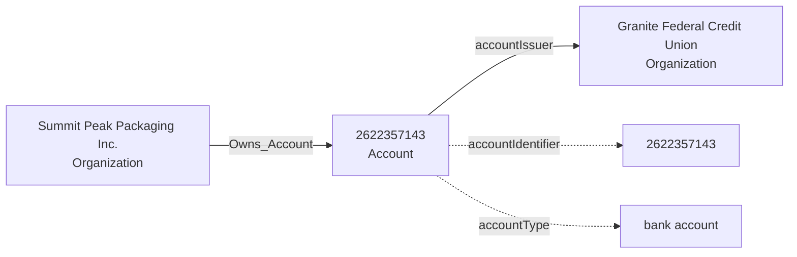
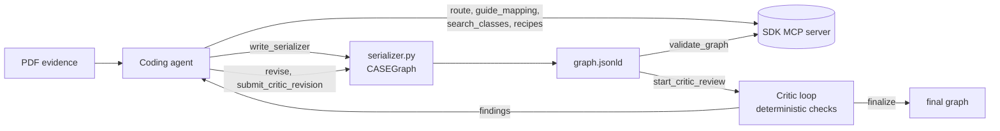
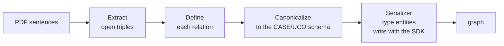
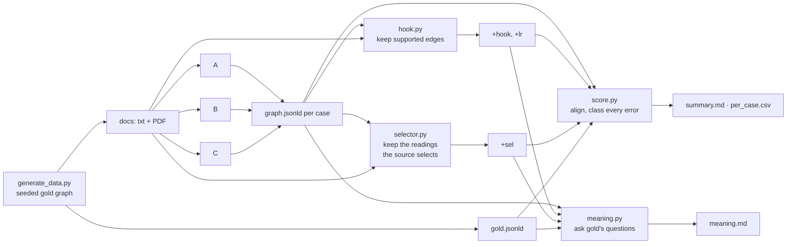

<h1 align="center">Evidence-Grounded Graph Construction</h1>
<h3 align="center">Evaluating the Semantic Fidelity of Machine-Constructed CASE/UCO Graphs</h3>

<p align="center">
  <em>Data in. Graphs out. True to the source.</em>
</p>

<p align="center">
  <a href="#the-problem">Problem</a> ·
  <a href="#the-hook">Hook</a> ·
  <a href="#the-selector">Selector</a> ·
  <a href="#graph-construction">Graph construction</a> ·
  <a href="#how-we-benchmark">Benchmark</a> ·
  <a href="#results">Results</a> ·
  <a href="#run-it">Run it</a> ·
  <a href="#whats-next">What's next</a>
</p>

---

## The problem

Making graphs that represent concepts from data is hard. Making knowledge graphs that faithfully reflect digital evidence is even harder.

When a language model turns case documents into [CASE](https://caseontology.org/)/[UCO](https://unifiedcyberontology.org/) graphs, the graphs can be *valid* (or pass the ontology's SHACL checks) without being ***correct***. A graph can be well-formed in every way the ontology can check and still represent things the documents never said.

This repo presents two checks of a finished graph against its source documents:

- **The hook** keeps each edge only if a source passage supports it.
- **The selector** lists every reading CASE/UCO allows for the entities the documents name, and keeps the ones the documents support.

Both are tested on three construction methods to determine whether they improve the reliability and semantic fidelity of CASE/UCO graphs. Here those terms mean:

- **Reliability**: does the method produce a graph at all, and does the graph validate?
- **Semantic fidelity**: does the graph, interpreted under CASE/UCO's definitions, mean what the evidence means?

Every method is benchmarked the same way, as built, after the hook and after the selector, using the same PDF documents, base model, and scorer against gold graphs we author ourselves, and therefore know completely.

The graph builders under test are Cory Hall's [CASE/UCO SDK](https://github.com/vulnmaster/CASE-UCO-SDK); direct generation by the base model, Qwen3.5-9B; and [EDC](https://github.com/clear-nus/edc).

## The hook

`harness/hook.py` works backward from a finished graph to the source, one edge at a time. It is the same for every method and uses no LLM; its two models are pinned in `harness/config.toml`: all-MiniLM-L6-v2 for retrieval and DeBERTa-v3-large NLI (MoritzLaurer/DeBERTa-v3-large-mnli-fever-anli-ling-wanli).

1. **Render**: each edge becomes one sentence, from a template filled with the CASE/UCO definitions of its classes and property (from the SDK's registry).
2. **Retrieve**: the sentence is embedded, and the 3 most similar source passages (sentences of the PDFs) are taken.
3. **Verify**: a local NLI model labels each (passage, sentence) pair as supported, contradicted, or not enough evidence.
4. **Keep or remove**: the edge stays if any passage supports it, citing that passage and its location; otherwise it is removed.

One sentence of evidence, from an incident summary (benchmark case_18, document D2):

> Account 2622357143 at Granite Federal Credit Union belongs to Summit Peak Packaging Inc.

states four edges of the gold graph:



The issuer edge, in parts:

```
Claim:  The account issuer of 2622357143 is Granite Federal Credit Union.
Where:  2622357143 is an Account (an arrangement with an entity to enable and control the provision of some capability or service).
        Granite Federal Credit Union is an Organization (a grouping of identifying characteristics unique to a group of people who work together in an organized way for a shared purpose).
        "account issuer" is accountIssuer (the issuer of this account).
```

The sentence NLI reads (`hook.render`, full template):

```
The account issuer (the issuer of this account) of 2622357143, an account (an arrangement with an entity to enable and control the provision of some capability or service), is Granite Federal Credit Union, an organization (a grouping of identifying characteristics unique to a group of people who work together in an organized way for a shared purpose).
```

**Hypothesis.** Checking each edge backward against the source removes unsupported edges from any method's graph at a small cost in true edges.

### Left hook and right hook

`hook.py --stage` splits the hook in two, run in order:

- **Left hook (fidelity)**: is the edge in the source? The edge's plain sentence (`The account issuer of 2622357143 is Granite Federal Credit Union.`) is checked against the passages, with a mail header read as one passage. An edge no passage supports is removed.
- **Right hook (semantics)**: is it the right edge? On the edges the left hook kept:
  - *Schema*: domain, range, datatype, cardinality and no self-loops, from the SDK's schema and registry.
  - *Header rule*: a message's time, sender and recipients are read from its mail header. The `Date:` line is when it was sent.
  - *Contrast*: the edge is removed if, on its passage, another reading the ontology allows for the same entities is entailed by more than a margin (`Granite Federal Credit Union owns 2622357143.` against the issuer edge).

**What it gives.** Every edge the hook keeps cites the passage, document and character offsets that support it, so what remains of the graph says only what a passage says and can be audited line by line. It decides only the edges a method wrote, and only by removing them: a fact the method missed stays missing, and a wrong edge is removed, not corrected.

## The selector

`harness/selector.py` works from the entities a finished graph names. The ontology lists what the graph could say about them; the source picks. It uses the hook's two models and no LLM.

1. **Merge**: entities of one class with one key (a name, an address, an account number) become one entity.
2. **Anchor**: each entity is placed in the passages that contain its key.
3. **List readings**: for every pair of entities that share a passage or an edge, every relation kind and object property whose domain and range fit, in either direction.
4. **Select**: each reading's plain sentence is scored by NLI on the passages the pair shares. A reading is kept when a passage entails it and no reading that cannot hold with it outranks it by more than the margin. Mail headers are read by rule: the `From:` and `To:` lines decide a message's sender, recipients and who corresponded.
5. **Write**: a kept reading the method wrote stays; one that replaces a wrong edge is a repair; one no edge stated is a recovery. A property CASE/UCO allows once keeps a value only when it wins by more than the margin, otherwise none.

The same sentence from case_18, and the readings the ontology allows for each pair it names (`selector.py`'s scores, entailment and log-odds):

```
Passage:  Account 2622357143 at Granite Federal Credit Union belongs to Summit Peak Packaging Inc.

Granite Federal Credit Union, 2622357143
  issued account   0.988  +4.37   kept: accountIssuer
  owns             0.006  -5.20

Summit Peak Packaging Inc., 2622357143
  owns             0.997  +5.71   kept: Owns_Account
  issued account   0.958  +3.13   outranked by 2.58, more than the margin (2.0)
```

A graph that wrote the credit union as the owner gets the issuer edge in its place; a graph that left the owner out gets it added. Every decision is a row in `sel.jsonl`, with the passage and the reason.

**Hypothesis.** Letting the ontology list the readings and the source pick repairs wrong edges and recovers missed ones, so the graph answers more of the evidence's questions, at some cost in precision against the hook.

## The reconciler

`harness/reconcile/` takes a finished graph, from any of the three arms or from none of them, and its documents, and writes the graph reconciled with the source beside a ledger that records why each edge stayed, left or entered. It uses the hook's two models and an LLM's cached reading of each document; no construction method is on its import path.

1. **Ingest**: every scored triple becomes a claim that keeps the node that stated it; entities of one class and one key become one.
2. **Verify**: each claim's sentence against the source: the top passages by the hook's embedder, each labelled by its NLI model, and the literal found beside its subject. Nothing is decided.
3. **Propose**: what the source may state and the graph lacks, as claims of the same kind: the readings the ontology allows for each pair of entities (the selector's list), a message's header facts, and the facts an LLM lists from each document, with values admitted only as exact spans and names resolved to the graph's entities. Every proposal gets the evidence a stated claim gets.
4. **Readings**: the schema's checks, and for every claim with support the readings that cannot hold with it, scored on the same passages.
5. **Decide**: one of five verdicts from the record alone: `supported`, `ambiguous`, `insufficient`, `contradicted`, `malformed`. A policy names the verdicts it removes (`conservative`: contradicted and malformed; `strict`: insufficient too, except an entity's key) and writes the proposals that clear the bar.
6. **Emit**: the input graph untouched, the reconciled graph, the ledger, and the run as a CASE `InvestigativeAction` with each removal and addition as an `Assertion` citing its passage and its reason.

The hook and the left and right hooks are two of its policies: `--policy hook-v1` and `--policy lr` keep the edges the published runs kept, edge for edge, on every graph they were run on.

**Hypothesis.** Deciding last, from one record that holds every pass's evidence for stated and proposed claims alike, removes what the hook removes with fewer true edges lost and adds what the selector adds and what an LLM reads that the selector cannot, and every change carries its reason.

**On dev** (`harness/results/rec-dev`, 20 cases, value scorer; the criteria and the ledgers' account are in EXPERIMENT.md, "Reconciler, dev"): the first part holds and the second does not. `conservative` removes 14 of gold's 1,459 true edges where the hooks removed 127 and the selector 98, and keeps 2-hop exact at 0.991. It recovers 134 of 241 dropped edges where the selector recovers 176. On corrupted graphs `strict` reaches precision 0.852 at recall 0.763, below the 0.90 set for it. On B it answers fewer questions exactly than B as built (0.394 against 0.494): what it removes is false under the strict scorer and credited by the questions. It has not been run on the test set.

## Graph construction

Every method gets the same task (the core classes; ten relation kinds), the same PDFs, and the same base model at temperature 0. A and B get the task as one statement (model only what the documents state); C gets it as EDC's target schema. The methods differ in how the graph is constructed. Each graph is scored as built, after the hook (`+hook`, `+lr`) and after the selector (`+sel`).

| arm | name | how the graph is constructed |
|---|---|---|
| **A** | SDK as shipped | the model writes a serializer script with the SDK, then revises it in the critic loop |
| **B** | direct | the model, in one reply |
| **C** | EDC | EDC extracts open triples, defines their relations, and canonicalizes them to the CASE/UCO schema |

### A. The SDK as shipped

A coding agent gets the SDK's MCP server tools plus a file reader and a "save and run this script" tool, and is asked to follow the SDK's documented workflow. The harness adds nothing to the graph; every node comes from the serializer the agent wrote.



`harness/pipeline_sdk_agent.py`, arm `a_sdk_agent`. The graph at the agent's first validation is also scored (`@first_validate`), so the QA loop's effect is visible.

### B. Direct generation

The model reads the documents and writes the CASE JSON-LD in one reply. No tools, no repair.

`harness/pipeline_monolith.py`, arm `b_control`.

### C. EDC

[EDC](https://aclanthology.org/2024.emnlp-main.548) (Extract, Define, Canonicalize; Zhang and Soh, 2024) in its target-alignment setting: open triples from each input, a definition for each relation, then each relation canonicalized to a target schema by embedding retrieval and an LLM choice. The target schema is the task in CASE/UCO terms: the ten relation kinds, and `Class.property` for each task property, defined from the SDK's registry. Each PDF sentence is one input. EDC does not type entities, so a thin serializer types each entity string from the domain and range of its relations and writes the graph with the SDK.



`harness/pipeline_edc.py`, arm `c_edc`; EDC is the submodule at `edc/`. C is also scored without the edges its serializer writes itself (`c_edc@no_adapter`). [EXPERIMENT.md](EXPERIMENT.md) lists every adaptation.

## How we benchmark

**100 cases, gold first.** Each case is a fraud or business-communication scenario. The gold graph is authored by a seeded generator, then rendered into 2 to 4 documents (memo, email, chat export, incident report) in which every gold statement is spoken in exactly one sentence. Each document is a PDF with no annotations. The methods receive the PDFs and nothing else.

**Scoring.** The scorer aligns the produced graph to gold entity by entity, counts supported statements, and classes every unsupported one: wrong value, wrong relation, wrong entity, conflation across documents, misplaced property, duplicate entity, invented. Strict and value-tolerant scores are both reported. Failures (no graph) count as zero recall. For a +hook condition, the scorer also counts the true edges the hook removed and checks each kept true edge's cited passage against the sentence that states it in gold.

**Grounding.** Separately, and without reference to gold, the scorer checks whether each assertion can be found in the source: a literal by its value in a sentence, a relation by its two endpoints in one sentence or one document. Every assertion falls into one cell of grounded by gold-supported. The grounded-but-unsupported cell holds the claims a method traced to the evidence and still modeled wrong.

**Meaning.** Separately from edge counts, `harness/meaning.py` asks each graph the questions its gold graph answers. A question starts from an entity's key value, as a query by value would, and takes one or two steps: "Who owns account 2622357143?", "Which organization employs the sender of message M?" Its answer is a set. A question is answered exactly when every gold answer is found and nothing else. 2-hop questions pass through an intermediate entity, so a split, merged or misdirected entity breaks them.

**Frozen protocol.** `harness/FROZEN.md` hashes the scorer, the generator, every gold graph and every pipeline. Scores are comparable only between runs under the same entry.

**Splits.** `harness/data/` is the benchmark and is test only. `harness/data_dev/` (20 cases) is for prompt and pipeline tuning. Different seeds, no shared case.

**Per-stage rows.** A snapshot a pipeline leaves (`graph_<stage>.jsonld`) is scored as `<arm>@<stage>`, hooked graphs as `<arm>+hook` and `<arm>+lr`, selected graphs as `<arm>+sel`.



## Results

The 100 test cases, A and B as built, after the hook (hook-v1) and after the selector, value scorer. Exact: the share of the gold graph's questions the graph answers completely and with nothing wrong. C's 100-case run and the left and right hooks on the test set are pending.

| condition | precision | recall | 1-hop exact | 2-hop exact | valid |
|---|---|---|---|---|---|
| A, SDK as shipped | 0.506 | 0.184 | 0.150 | 0.088 | 35 |
| A + hook | 0.547 | 0.153 | 0.116 | 0.055 | 39 |
| A + selector | 0.581 | 0.163 | 0.127 | 0.066 | 42 |
| B, direct | 0.595 | 0.476 | 0.498 | 0.394 | 91 |
| B + hook | 0.632 | 0.432 | 0.448 | 0.297 | 93 |
| B + selector | 0.648 | 0.437 | 0.449 | 0.303 | 93 |

- **Both checks make what the graph says more trustworthy.** Precision rises on both arms, most under the selector, and more graphs validate. On dev graphs with planted errors, the share of right answers rises from 52% to 94% after the hook, and every kept edge cites its passage.
- **Neither makes the graph mean more of what the evidence means.** Both answer fewer questions than the graph as built. The answers A and B give are mostly right already; most questions fail on answers the graph does not hold.
- **The selector does not meet its success criteria.** It beats the hook on every measure above and stays below the graph as built on questions answered. On B, 10% of the missed gold facts are links between entities B wrote, the only kind the selector can add; the rest need literals or entities the method never wrote. On dev, where every entity is present, it raised questions answered exactly from 38% to 71% on graphs with planted errors.

[EXPERIMENT.md](EXPERIMENT.md) has the dev results, the criteria written before the test run, and every disclosure.

## Run it

```bash
git clone --recurse-submodules https://github.com/mrinaalr/case-uco-graph-integrity.git && cd case-uco-graph-integrity
```

```bash
python3.13 -m venv .venv && .venv/bin/pip install -r requirements.txt
```

Put API keys in `harness/.env` (gitignored), named by `api_key_env` in `harness/config.toml`; the default endpoint is Tinker's OpenAI-compatible API serving Qwen3.5-9B.

```bash
.venv/bin/python harness/pipeline_sdk_agent.py --run-id RUN --model tinker
```

```bash
.venv/bin/python harness/pipeline_monolith.py --run-id RUN --model tinker
```

```bash
.venv/bin/python harness/pipeline_edc.py --run-id RUN --model tinker
```

```bash
for arm in a_sdk_agent b_control c_edc; do .venv/bin/python harness/hook.py --run-id RUN --arm $arm; done
```

```bash
for arm in a_sdk_agent b_control c_edc; do .venv/bin/python harness/hook.py --run-id RUN --arm $arm --stage left,right,both; done
```

```bash
for arm in a_sdk_agent b_control c_edc; do .venv/bin/python harness/selector.py --run-id RUN --arm $arm; done
```

```bash
.venv/bin/python harness/reconcile/propose_llm.py --run-id RUN --out harness/results/RUN/proposals
```

```bash
for arm in a_sdk_agent b_control c_edc; do .venv/bin/python harness/reconcile/run.py --run-id RUN --arm $arm --policy conservative,strict --proposals harness/results/RUN/proposals; done
```

```bash
.venv/bin/python harness/score.py --run-id RUN
```

```bash
.venv/bin/python harness/meaning.py --run-id RUN
```

```bash
.venv/bin/python harness/calibration.py --run-id RUN
```

```bash
.venv/bin/python -m pytest
```

- `--cases case_01,case_02` runs a subset; `--data data_dev` runs on the dev set.
- Results go to `harness/results/RUN/`; `summary.md` has the per-arm table, `meaning.md` the questions answered and `calibration.md` each verdict against gold. The hook writes `<arm>+hook/` (or `+left`, `+right`, `+lr`), the selector `<arm>+sel/` and the reconciler `<arm>+rec/` and `<arm>+rec-strict/` next to each arm, each case with its `ledger/`, `provenance.jsonld` and the input graph it read; all three download the same two models on first use.
- The reconciler's test run on the 100 cases is a GPU job (six model passes over three arms; the dev run of 20 cases took about 80 minutes on an M-series laptop) and has not been run.
- `harness/generate_data.py --validate` regenerates the benchmark and its PDFs.
- [harness/README.md](harness/README.md) documents every arm, the data, and the scorer in detail.

## What's next

- Run C, then the left and right hooks on all three arms, on the 100 cases (pending the GPU run); A and B with hook-v1 are in `harness/results/hook-v1/`.
- The selector on C's 100 graphs, and against `+lr` on A and B.
- The reconciler on the 100 cases, under the criteria in EXPERIMENT.md (a GPU job; every reconciler number so far is dev).
- Entity repair: the selector fixes edges, not entities. A person written as an email address, or by first name alone, keeps the facts that land on it.
- The issuer and the owner of an account: where one passage names both organizations, NLI reads both as the issuer often enough that the selector abstains.
- An adversarial set: the same 100 cases with one injected attack per case (instruction, false fact, format, tool) and an "injected" error class in the scorer, to measure which method lets poisoned evidence into the graph and which leaves a trail to it.
- Tests with fixtures and mocked model replies, starting with the one that matters: an edge the hook removes cannot reach the hooked graph.

## Limitations

The cases are synthetic. They test mechanics and known failure modes; they do not establish fidelity on real case documents, which needs independently reviewed source-to-claim annotations. One base model so far.

The hook checks that a passage supports an edge, not that the edge is true: a false statement physically in a document passes, though every kept edge cites the passage that supports it. Support is also weaker than role: in hook-v1 the hook kept all 16 issuer edges from A and B that named the account's owner, because the passage names both organizations. And it reads one sentence at a time, so a true fact spread over lines, as in an email header, is removed.

The selector shares the hook's NLI model and its limits, and adds its own. It adds no entity, so it cannot recover a fact about an entity the method left out or wrote wrong. Facts set by convention, as in an email header, are read by rules written for mail headers. Its design was changed on the dev set after reading dev output (EXPERIMENT.md lists each change); the test set was run once, under a frozen entry.

The reconciler shares both models and their limits: an account's issuer and its owner are still one reading to NLI where a passage names both, and a chat line has no header rule. It proposes new entities only of classes a name identifies (a person, an organization, an account, an address); an event or a location the graph lacks is not recovered. Its design was changed once on the dev set after reading the first dev run's ledgers (EXPERIMENT.md lists each change); the second run's ledgers show two more faults, left as found: an address written in full enters as a second `street`, and an `accountType` outside the SDK's vocabulary enters. It has not been run on the test set.

## History

[DIRECTION.md](DIRECTION.md) records the study of the SDK's critic loop that led here, and [EXPERIMENT.md](EXPERIMENT.md) the design of this experiment. `harness/findings/` holds the SDK findings sent upstream.