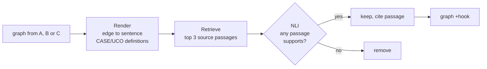
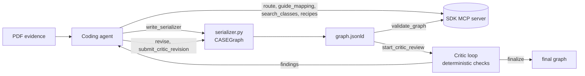
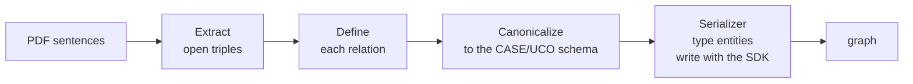
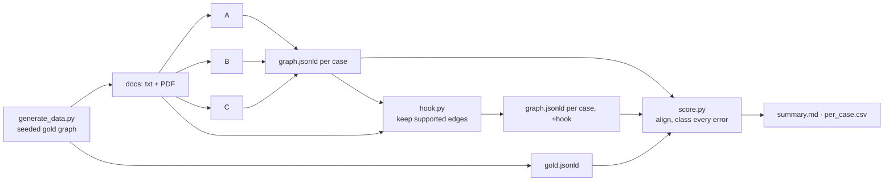

<h1 align="center">Evidence-Grounded Graph Construction</h1>
<h3 align="center">Evaluating the Semantic Fidelity of Machine-Constructed CASE/UCO Graphs</h3>

<p align="center">
  <em>Data in. Graphs out. True to the source.</em>
</p>

<p align="center">
  <a href="#the-problem">Problem</a> ·
  <a href="#the-hook">Hook</a> ·
  <a href="#the-methods">Methods</a> ·
  <a href="#how-we-benchmark">Benchmark</a> ·
  <a href="#run-it">Run it</a> ·
  <a href="#whats-next">What's next</a>
</p>

---

## The problem

Making graphs that represent concepts from data is hard. Making knowledge graphs that faithfully reflect digital evidence is even harder.

When a language model turns case documents into [CASE](https://caseontology.org/)/[UCO](https://unifiedcyberontology.org/) graphs,
constructed graphs can be *valid* (or pass ontology's SHACL checks) without being ***correct***. A graph can be well-formed in every way the ontology can check and still represent things the documents never said.

This repo presents a backward verification hook: every edge of a finished graph is checked against the source documents, read under CASE/UCO's definitions, and kept only if a source passage supports it. The hook is tested on three construction methods to determine whether verification improves the reliability and semantic fidelity of CASE/UCO graphs. Here those terms mean:

- **Reliability**: does the method produce a graph at all, and does the graph validate?
- **Semantic fidelity**: do the assertions in the graph trace to the source material, and does the graph, interpreted under CASE/UCO's definitions, mean what the evidence means?

Every method is benchmarked the same way, with and without the hook, using the same PDF documents, base model, and scorer against gold graphs we author ourselves, and therefore know completely.

The graph builders under test are Cory Hall's [CASE/UCO SDK](https://github.com/vulnmaster/CASE-UCO-SDK); direct generation by the base model, Qwen3.5-9B; and [EDC](https://github.com/clear-nus/edc).

## The hook

`harness/hook.py` checks a finished graph edge by edge, backward from the graph to the source.
It is the same for every method and uses no LLM; its two models are pinned.

1. Render: each edge becomes one sentence from a template filled with the CASE/UCO definitions
   of its classes and property, from the SDK's registry.
2. Retrieve: the sentence is embedded and the 3 most similar source passages (sentences of the
   PDFs) are taken.
3. Verify: a local NLI model labels each (passage, sentence) pair supported, contradicted, or not
   enough evidence.
4. Policy: the edge stays if any passage supports it, citing that passage and its location;
   otherwise it is removed.

A rendered edge:

```
Luca Petrov, a person (a grouping of identifying characteristics unique to a human being regarded
as an individual), is employed by Oakhaven Services LLC, an organization (a grouping of identifying
characteristics unique to a group of people who work together in an organized way for a shared purpose).
```



Per edge, `hook.jsonl` records the triple, the sentence, the passages with their locations and
verdicts, and the decision. The models, pinned in `harness/config.toml`: all-MiniLM-L6-v2 for
retrieval and DeBERTa-v3-large NLI (MoritzLaurer/DeBERTa-v3-large-mnli-fever-anli-ling-wanli).

`--contrast` adds a fifth step: a supported edge must also outrank, on the same passage, the other
readings the ontology allows for it, such as another relation kind between the same two entities or
another value of a single-valued property. Opt-in; results in [EXPERIMENT.md](EXPERIMENT.md#contrast).

**Hypothesis.** Checking each edge backward against the source, under CASE/UCO's definitions,
removes unsupported edges from any method's graph at a small cost in true edges.

## The methods

Every method gets the same task (the core classes; ten relation kinds), the same PDFs, and the
same base model at temperature 0. A and B get it as one task statement (model only what the
documents state); C gets it as EDC's target schema. They differ in one thing: **how the graph
is constructed.** Each runs as shipped, and each graph is scored with and without the hook:
three arms by {baseline, +hook}, six conditions.

| arm | name | how the graph is constructed |
|---|---|---|
| **A** | SDK as shipped | the model writes a serializer script with the SDK, then revises it in the critic loop |
| **B** | direct | the model, in one reply |
| **C** | EDC | EDC extracts open triples, defines their relations, and canonicalizes them to the CASE/UCO schema |

### A. The SDK as shipped

A coding agent gets the SDK's MCP server tools plus a file reader and a "save and run this
script" tool, and is asked to follow the SDK's documented workflow. The harness adds nothing to
the graph; every node comes from the serializer the agent wrote.



`harness/pipeline_sdk_agent.py`, arm `a_sdk_agent`. The graph at the agent's first validation
is also scored (`@first_validate`), so the QA loop's effect is visible.

### B. Direct generation

The model reads the documents and writes the CASE JSON-LD in one reply. No tools, no repair.

`harness/pipeline_monolith.py`, arm `b_control`.

### C. EDC

[EDC](https://aclanthology.org/2024.emnlp-main.548) (Extract, Define, Canonicalize; Zhang and
Soh, 2024) in its target-alignment setting: open triples from each input, a definition for each
relation, then each relation canonicalized to a target schema by embedding retrieval and an LLM
choice. The target schema is the task in CASE/UCO terms: the ten relation kinds, and
`Class.property` for each task property, defined from the SDK's registry. Each PDF sentence is
one input. EDC does not type entities, so a thin serializer types each entity string from the
domain and range of its relations, writes the string as the entity's name or identifier, and
writes the graph with the SDK.



`harness/pipeline_edc.py`, arm `c_edc`; EDC is the submodule at `edc/`. The edges the
serializer writes itself are listed per case, and C is also scored without them
(`c_edc@no_adapter`). [EXPERIMENT.md](EXPERIMENT.md) lists every adaptation.

## How we benchmark

**100 cases, gold first.** Each case is a fraud or business-communication scenario. The gold
graph is authored by a seeded generator, then rendered into 2 to 4 documents (memo, email,
chat export, incident report) in which every gold statement is spoken in exactly one sentence.
Each document is a PDF with no annotations. The methods receive the PDFs and nothing else.

**Scoring.** The scorer aligns the produced graph to gold entity by entity, counts supported
statements, and classes every unsupported one: wrong value, wrong relation, wrong entity,
conflation across documents, misplaced property, duplicate entity, invented. A strict scorer and
a value-tolerant scorer are both reported. Failures (no graph) count as zero recall. For a +hook
condition the scorer also counts the true edges the hook removed, and checks each kept true
edge's cited passage against the sentence gold states it in.

**Grounding.** Separately, and without reference to gold, the scorer checks whether each emitted
assertion can be found in the source text: a literal by its value in a sentence, a relation by
its two endpoints in one sentence or one document. Every assertion then falls into one cell of
grounded by gold-supported. The grounded-but-unsupported cell holds the claims a method could
trace to the evidence and still modeled wrong.

**Frozen protocol.** `harness/FROZEN.md` hashes the scorer, the generator, every gold graph and
every pipeline. Scores are comparable only between runs under the same entry.

**Splits.** `harness/data/` is the benchmark and is test only. `harness/data_dev/` (20 cases)
is for prompt and pipeline tuning. Different seeds, no shared case.

**Per-stage rows.** Any snapshot a pipeline leaves (`graph_<stage>.jsonld`) is scored as
`<arm>@<stage>`, so A before its QA loop shows up as its own row. The hook's graphs are scored as
`<arm>+hook`, and C without its serializer's own edges as `c_edc@no_adapter`.



## Run it

```bash
git clone --recurse-submodules https://github.com/mrinaalr/case-uco-graph-integrity.git && cd case-uco-graph-integrity
```

```bash
python3.13 -m venv .venv && .venv/bin/pip install -r requirements.txt
```

Put API keys in `harness/.env` (gitignored), named by `api_key_env` in `harness/config.toml`;
the default endpoint is Tinker's OpenAI-compatible API serving Qwen3.5-9B.

```bash
.venv/bin/python harness/pipeline_sdk_agent.py --run-id RUN --model tinker
```

```bash
.venv/bin/python harness/pipeline_monolith.py --run-id RUN --model tinker
```

```bash
.venv/bin/python harness/pipeline_edc.py --run-id RUN --model tinker
```

```bash
for arm in a_sdk_agent b_control c_edc; do .venv/bin/python harness/hook.py --run-id RUN --arm $arm; done
```

```bash
.venv/bin/python harness/score.py --run-id RUN
```

- `--cases case_01,case_02` runs a subset; `--data data_dev` runs on the dev set.
- Results go to `harness/results/RUN/`; `summary.md` has the per-arm table. The hook writes
  `<arm>+hook/` next to each arm and downloads its two models on first use.
- `harness/generate_data.py --validate` regenerates the benchmark and its PDFs.
- [harness/README.md](harness/README.md) documents every arm, the data, and the scorer in detail.

## What's next

- Run C and its hook on the 100 cases to complete the six conditions; A and B with the hook are in
  `harness/results/hook-v1/`.
- Passages that span an email header block, so header facts can be checked.
- An adversarial set: the same 100 cases with one injected attack per case (instruction, false
  fact, format, tool) and an "injected" error class in the scorer, to measure which method lets
  poisoned evidence into the graph and which leaves a trail to it.
- Tests with fixtures and mocked model replies, starting with the one that matters: an edge the
  hook removes cannot reach the hooked graph.

## Limitations

The cases are synthetic. They test mechanics and known failure modes; they do not establish
fidelity on real case documents, which needs independently reviewed source-to-claim
annotations. One base model so far. The hook is not immune to false statements that are
physically in a document; what it adds is that every kept edge cites the passage that supports
it. It reads one sentence at a time, so a true fact spread over lines, as in an email header, is
removed.

## History

[DIRECTION.md](DIRECTION.md) records the study of the SDK's critic loop that led here, and
[EXPERIMENT.md](EXPERIMENT.md) the design of this experiment. `harness/findings/` holds the SDK
findings sent upstream.
